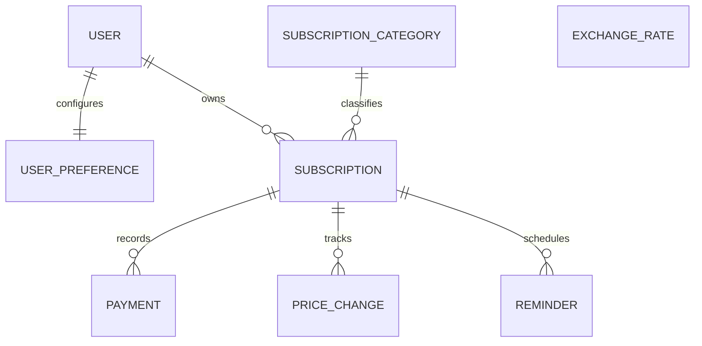

# Техническое задание — SubWatch

## 1. Название и концепция

**SubWatch — веб-система учёта подписок и анализа регулярных расходов.**

Сервис помогает частным пользователям контролировать платные подписки и другие периодические платежи: хранить условия оплаты, отслеживать даты следующих списаний, видеть месячную и годовую финансовую нагрузку, сохранять историю оплат и изменений стоимости. Для сопоставления подписок в разных валютах система получает справочные курсы через внешний API.

## 2. Целевая аудитория и роли

- **Гость:** знакомится с назначением сервиса и может создать аккаунт или войти.
- **Авторизованный пользователь:** управляет только своими подписками, категориями расходов, напоминаниями, платежами и личной валютой отчётов.
- **Администратор:** управляет справочником категорий и контролирует данные через Django Admin.

Каждый пользователь имеет изолированное пространство данных. Доступ к объектам проверяется на сервере по владельцу.

## 3. Модели и связи

1. **UserPreference** — настройки пользователя; связь OneToOne с `django.contrib.auth.User`; хранит основную валюту отчётов и стандартный срок напоминания.
2. **SubscriptionCategory** — справочник категорий подписок; одна категория связана со многими подписками.
3. **Subscription** — подписка пользователя; FK на пользователя и категорию; сумма, валюта, периодичность, следующая дата платежа, статус и условия.
4. **Payment** — история фактических платежей; FK на подписку; сумма, исходная валюта, дата, статус и зафиксированная сумма пересчёта в валюту пользователя.
5. **PriceChange** — история изменений цены; FK на подписку; прежняя и новая стоимость, валюта и дата изменения.
6. **Reminder** — правило напоминания; FK на подписку; количество дней до платежа и флаг активности.
7. **ExchangeRate** — сохранённый снимок валютного курса; базовая и целевая валюты, курс и дата источника.

Все собственные модели связаны с предметной областью. История платежей и цен позволяет анализировать фактические траты и изменения условий, а снимки курсов сохраняют объяснимость конвертации.

## 4. Основные пользовательские сценарии

1. Как пользователь, я регистрируюсь и выбираю основную валюту, чтобы видеть общие расходы в привычном формате.
2. Как пользователь, я добавляю подписку с суммой, валютой, периодичностью и следующей датой списания, чтобы учитывать будущие платежи.
3. Как пользователь, я открываю панель управления и вижу месячный эквивалент затрат, годовой прогноз и ближайшие списания.
4. Как пользователь, я отмечаю оплату, чтобы сохранить историю платежей и автоматически перенести следующую дату списания.
5. Как пользователь, я изучаю аналитику по месяцам и категориям, чтобы находить основные источники регулярных расходов.

## 5. Технический стек и интеграции

- Python 3.13, Django 5.2 LTS, Django ORM.
- SQLite для локальной разработки; возможность подключения PostgreSQL через `DATABASE_URL`.
- Django Forms / ModelForms и серверная проверка пользовательских данных.
- Requests для интеграции с Frankfurter API v2 (`https://api.frankfurter.dev/v2/rates`) — получение справочных курсов для пересчёта подписок.
- Pandas для подготовки временных рядов и группировки фактических платежей по месяцам и категориям.
- Chart.js для визуализации аналитики на клиенте.
- Bootstrap 5 и собственные CSS-стили для адаптивного интерфейса.
- Django Admin для управления всеми собственными моделями.
- SMTP/email backend и management-команда для отправки напоминаний.

## 6. Ключевая бизнес-логика

- Приведение периодических платежей к месячному эквиваленту: неделя × 52 / 12; месяц × 1; квартал / 3; год / 12.
- Расчёт годового прогноза как месячного эквивалента × 12.
- Конвертация валюты подписки в основную валюту пользователя по справочному курсу API. Если курс недоступен, приложение не подменяет его нулём: такой платёж помечается как не сконвертированный.
- При записи успешного платежа сохраняется сумма в исходной валюте и снимок конвертации на дату платежа, затем следующая дата списания сдвигается на один расчётный период.
- Изменение цены фиксируется отдельной записью истории.
- Ежедневная management-команда находит напоминания с наступившей датой отправки и отправляет email; повторная отправка в тот же день блокируется полем `last_sent_at`.
- Все выборки объектов ограничиваются текущим пользователем.

## 7. Проверка качества

В проект включены 33 автоматизированных теста: расчёт месячного и годового эквивалента, перенос даты платежа, запись успешного и неуспешного платежа, валидация форм, изоляция данных пользователей, конвертация валют с mock API, подготовка аналитики, REST API, регистрация и настройки аккаунта, приватность панели управления, идемпотентность демо-наполнения и отправка email-напоминаний.

## 8. Схема данных (ER-диаграмма)

`ExchangeRate` хранит снимки курсов валютных пар; связь с конкретным пользователем не требуется, поскольку курсы являются общими справочными данными.

## 9. REST API

Дополнительно реализован REST API (Django REST Framework), доступный только авторизованным пользователям:

- `GET /api/v1/subscriptions/` — список своих подписок; доступны поиск, фильтр по статусу/категории и сортировка.
- `POST /api/v1/subscriptions/` — создание подписки; владелец назначается сервером из текущей сессии/API-аутентификации.
- `GET /api/v1/subscriptions/{id}/` — подробности своей подписки.
- `PATCH /api/v1/subscriptions/{id}/` и `DELETE /api/v1/subscriptions/{id}/` — изменение и удаление только своей подписки.
- `GET /api/v1/payments/` — история платежей только по своим подпискам.
- `GET /api/v1/categories/` — справочник категорий.

API использует пагинацию и проверку прав на уровне QuerySet; передача чужого `user_id` не позволяет получить или изменить чужие данные.

## 10. Дополнение к проверке качества

REST API покрыт отдельными тестами на создание объекта, изоляцию данных, аудит изменения стоимости и запрет доступа без авторизации. Pandas отвечает за группировку временных рядов и категорий, а Django ORM выполняет `Count`, `Sum` и `Avg` для контрольных агрегатов.

## 11. Изменения в ходе реализации

- 24.11.2026: расширено автоматизированное покрытие с 22 до 33 тестов; добавлены сценарии регистрации, пользовательских настроек, приватности панели, демо-данных и email-напоминаний. Полный GitHub Actions pipeline успешно пройден для Python 3.12 и 3.13.

- 24.11.2026: добавлены REST endpoints для подписок, платежей и категорий; API ограничивает выборки текущим пользователем, автоматически создаёт напоминание при добавлении подписки и сохраняет аудит изменения стоимости.
- 24.11.2026: агрегаты общей суммы, среднего платежа и количества платежей перенесены на Django ORM; группировки графиков и рейтинги категорий остаются на Pandas.
- 24.11.2026: добавлено AJAX-действие для приостановки и возобновления подписки через защищённый REST endpoint без перезагрузки страницы.
